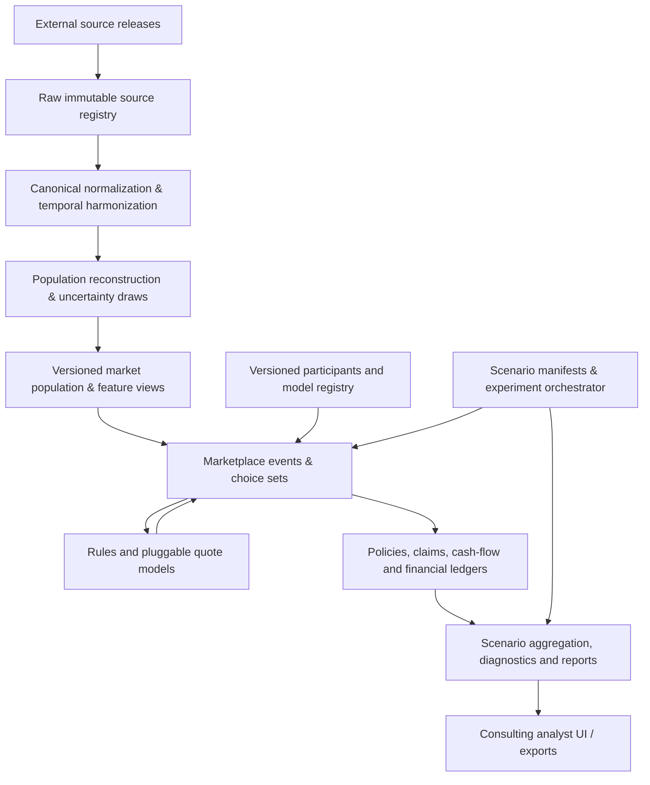

# System architecture — consulting-first modular platform

**Status:** proposed v0.1; superseded choices must be recorded as ADRs.

## Logical layers

## Bounded contexts

| Context | Responsibilities | Key outputs |
|---|---|---|
| Source catalogue | Discovery, licences, ingestion history, checksums, dates | Source manifests |
| Canonical data | Semantic mapping and normalization; data-quality diagnostics | Harmonized tables |
| Population | Stock/flow reconciliation, calibrated synthesis, draws and weights | Population releases |
| Market features | Consistent vehicle, owner, driver, usage, geography and cover features | Versioned feature views |
| Participant registry | Group/carrier/brand/product relationships; appetite and effective configurations | Participant releases |
| Model registry | Typed pluggable underwriting, pricing, choice, risk, expense adapters | Immutable model versions |
| Marketplace | Demand events, quote sets, customer choice, retention and transfers | Policy/event ledger |
| Risk and finance | Frequency/severity, CAT dependencies, reserves, financial reporting and capital | Financial/event ledgers |
| Experiments | Nested uncertainty, random streams, runs, validation, comparisons | Reproducible scenario outputs |
| Consulting | Client workspace permissions, dashboards and narrative exports | Reviewed reports |

## Deployment architecture (provisional)

Start as a **modular Python monolith with ports/adapters**. This enables unit testing, efficient batch simulations and an eventual separation into separately deployed services without premature distributed-system overhead.

- **Analytical storage:** columnar Parquet, partitioned by release and sensible geography/period keys; use Arrow-compatible schema contracts. DuckDB/Polars are candidates, not fixed requirements.
- **Metadata/control plane:** manifests in Git initially; a transactionally managed store (possibly PostgreSQL) when concurrent scenario editing and tenant permissions emerge.
- **Batch plane:** local development and deterministic chunked execution first; object storage and distributed workers after benchmarks justify them.
- **User interfaces:** research notebooks or a lightweight analyst app first; a separate consulting client portal only when access and workflow requirements are clear.
- **Cloud:** unspecified; local/open format-first, with IaC under `infra/` once non-functional requirements are measured.
- **No external network required to run deterministic baseline tests.**

## Data flow and release boundaries

1. Register a source with grain, licence, coverage, published date, observation reference date and checksum.
2. Ingest immutable bytes to controlled external storage; stage a row count and schema report.
3. Normalize into canonical reference and observation tables; preserve raw-to-canonical mapping.
4. Reconcile controls; generate one or more plausible populations and diagnostics.
5. Publish an immutable population release and optional weighted analysis view.
6. Pin population, model versions, participant configurations and random stream manifest for every experiment.
7. Produce event/financial ledgers and output distributions; retain lineage and validation.

**Do not** update an existing release in place, reinterpret an event transaction as a stock, assume source vintages refer to the same date, or substitute a newly trained model in a historical experiment.

## Port definitions

- `SourceAdapter`: `discover/fetch/parse` with source manifest.
- `Normalizer`: canonicalize fields, codes, reference dates and geographical units.
- `PopulationSynthesizer`: controls + assumptions + seed → population/weights + diagnostics.
- `FeatureProvider`: immutable feature view/version for a requested batch.
- `RuleEvaluator`: batch eligibility/reason/terms, independent of commercial price.
- `ModelRunner`: batch input + context → typed output, no algorithm-specific dependency.
- `ChoiceModel`: alternatives + customer context → normalized probabilities incl. outside option.
- `EventEngine`: market changes and recorded transitions.
- `FinancialLedger`: premiums, earned exposure, claims, expenses, reinsurance and capital.
- `ScenarioRunner`: pinned dependencies + random streams → run artefacts and comparisons.

Implementations may run in-process, through a file-based adapter or through a service endpoint. Each port needs a contract test suite.

## Core non-functional requirements

- **Scale:** plan for tens of millions of source fleet records while allowing weighted samples for simulation; benchmark rather than promise throughput.
- **Determinism:** explicit PRNG algorithm, seeds and substream IDs; partition/order independence where feasible.
- **Performance:** batch API for quotes, lazy feature materialization and event-driven shopping rather than repricing every vehicle every day.
- **Correctness:** invariants on fleet controls, sums of weights, policy transfers and financial accounting.
- **Security:** public code/metadata separate from private data and tenant artefacts; no raw personal data in Git.
- **Observability:** run manifest, source lineage, warning logs, calibration error, timing, cost and model diagnostics.
- **Extensibility:** feature/model semantic versions and migrations; shared model invocation regardless of ML framework.

## Repository choice

One monorepo now; code and documentation changes can be reviewed atomically. Split a pricing service, analyst portal or ingestion service only when it has a clear independent release cadence, separate access requirements or operational owner. See [ADR-0001](decisions/ADR-0001-monorepo.md).

## Architecture review gates

Before M1 code, approve source/grain taxonomy, vehicle and geography keys, version manifests and fleet control policy. Before marketplace simulation, approve model interface, participant hierarchy, choice-set definition and financial ledgers. Before external consulting, commission legal/privacy review and calibrate independent benchmark outputs.
