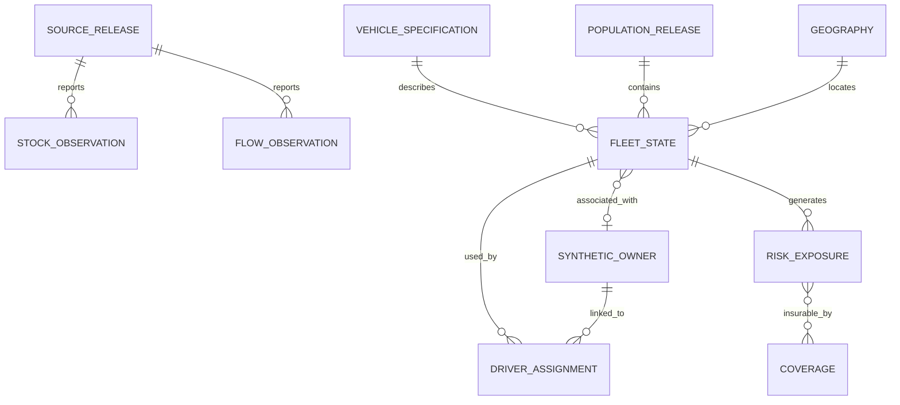

# Canonical data and feature model

**Status:** logical v0.1; physical Arrow schemas, key lengths and types will be finalized after representative source inspection. Proposed units are explicit to prevent false joins.

## 1. Entity relationships

## 2. Required canonical entities

| Entity/table | Grain and primary key | Important fields and semantics |
|---|---|---|
| `source_release` | One received publication/version; `source_release_id` | publisher, resource URL, checksum, licence, reference period, published/acquired timestamps, scope |
| `stock_observation` | One published stock aggregate cell at source reference date; `source_release_id + cell_id` | state, class, make, fuel, year, geography level, `vehicle_count`, suppression/rounding flags |
| `flow_observation` | One transaction/event aggregate or permitted de-identified event; `source_release_id + event_id` | event class (new registration/transfer/deregistration), date interval, geography, `event_count`, source event grain |
| `vehicle_specification` | Vehicle type/configuration; `vehicle_spec_id` | make, model, variant, body, fuel, manufacture-year applicability, class, technical reference version |
| `population_release` | One immutable synthetic population draw/version; `release_id` | reference date, universe, controls, input hashes, model versions, draw ID, validation |
| `fleet_state` | One synthetic vehicle's state in one release/reference date; `release_id + vehicle_id` | spec ID, state/postcode, manufacture year, stock scope, registration class, synthetic status, sampling weight |
| `geography` | Code and geography vintage; `geography_scheme + code + valid_from` | state, postcode/SA2, crosswalk quality, reporting suppression |
| `owner_entity` | Synthetic household/business within enrichment release; `enrichment_release_id + owner_id` | entity type, composition, region, attributes/weights where supported |
| `driver_assignment` | Driver-to-vehicle relation for time/exposure; composite key | synthetic driver, vehicle, share/role, relevant interval |
| `usage_exposure` | Vehicle x usage period x usage model version | usage purpose, kms/time, garaging, assumptions, model |
| `insurance_need` | Vehicle/owner/cover x period | interest in cover, coverage requirement, insured/uninsured state (derived) |
| `risk_exposure` | Risk object x cover/peril x earned exposure period | cover type, peril, duration fraction, exposure unit, geographic reference |
| `feature_view` | Named semantic version of a feature contract | feature names, types, units, required/optional, derivation and missingness rule |

All synthetic IDs are pseudorandom internal keys and **not** source VIN/registration identifiers. Keys do not imply stable identity across independently generated releases; trajectory IDs will be separately introduced if continuity is modelled.

## 3. Core types / semantics

- `vehicle_count`: nonnegative integer aggregate count, never insurance policy count.
- `sampling_weight`: strictly positive finite number of fleet vehicles represented by sample row; full-population materialization uses 1.
- `exposure_years`: nonnegative time at risk for a specific insurance cover, not the same as registration count.
- `annual_km`: kilometres/year, an observed or model-derived **usage** feature with uncertainty.
- `vehicle_value_aud`: reference-date insured/market value with value basis and source; do not assign one value from make/year alone without marking estimate.
- `fleet_scope`: `registered_unrestricted`, `registered_restricted`, `unregistered_insurable_extension`, or `other_excluded`.
- `ownership_type`: private, commercial, government, unknown (taxonomy versioned).
- `fuel_type`: versioned canonical category, preserving original source codes.
- `observation_date`: business date to which a stock value relates (not extraction date).
- `event_time_utc`: exact event timestamp when available; period start/end for aggregated flows.
- `published_at`, `acquired_at`: temporal lineage timestamps, UTC.

Never encode missing values as zero or as a plausible sampled value without an imputation indicator and derivation lineage. Define `unknown`, `not_applicable`, `suppressed` and genuinely unobserved independently.

## 4. Source-to-canonical mapping example

| Source value | Canonical feature | Method | Risk |
|---|---|---|---|
| VIC make/year/fuel/postcode count | `stock_observation` with joint dimensions | direct aggregate map + taxonomy | incorrect or outdated codes, postcode ambiguity |
| QLD 2022 vehicle records | historical `vehicle_specification` / conditional distribution | parse rows; never assume 2026 stock | vintage shift and selection/scope |
| BITRE state/category count | `stock_observation` national controls | report table normalization | definition mismatch with jurisdiction data |
| QLD new registrations / transfers | `flow_observation` | event-type-aware map | a transfer is not fleet growth |
| ABS household vehicles | `owner_entity` distributions | demographic conditional model | different year and unit of analysis |
| APRA motor insurance aggregates | `insurance_benchmark` outside fleet core | calibrate separate finance layer | accounting definitions/time periods |

## 5. Denormalized model views

The **feature builder**, not source ingestion, generates `market_vehicle_features_vX` materialized columns needed by pricing and simulations. Examples: `vehicle_age_at_quote`, `garaging_region`, `driver_age_band`, `vehicle_value_aud`, `annual_km`, `coverage_type`, `risk_flood_proxy`. Each view declares input releases, feature derivations, and imputation policy. Event-time values (age, valuation) must be computed at quote/coverage date, not copied permanently from an earlier fleet snapshot.

For downstream model input, use typed batch columns and distinct view identifiers; do not make every model dependent on the entire flat population table. A producer may add features without breaking consumers, but changing meaning/units needs a new major semantic version.

## 6. Structural/relational invariants

- Exactly one reference-date state per `(release_id, vehicle_id)`.
- Every fleet state resolves a valid vehicle specification, location and release, or explicitly marked unresolved mapping.
- Weights are finite/positive; weighted population totals match declared controls within documented tolerances.
- All derived ownership/driver relations refer to synthetic entities in the correct enrichment release.
- Coverage periods and event times cannot silently cross reference snapshots without a supported transition.
- Product eligibility and policy counts are **not** attributes of the permanent vehicle specification.
- A policy can carry multiple vehicle exposures; a vehicle can have multiple non-overlapping/compatible cover definitions subject to modelled rules.

## 7. Evolution approach

Start with logical contract tables and a small example fixture. Prototype Arrow schema after inspecting source column formats and granularity; validate join cardinality and geographic totals before optimizing partitioning. All schema changes require migration rules, compatibility tests and an ADR when semantics materially change.
